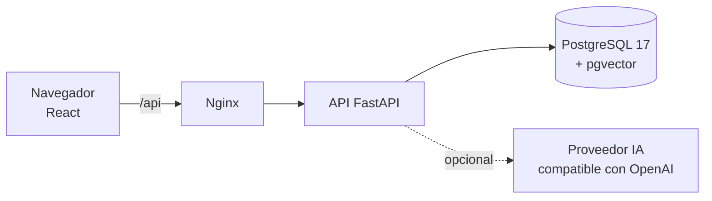

# Ateneo

**Asistente académico para la Licenciatura en Derecho de la Universidad de Pinar del Río.**
Responde preguntas, genera material de estudio y crea exámenes de práctica usando **solo la bibliografía oficial**, siempre con la cita exacta del documento y la página de donde sale cada afirmación.

**Demo:** https://ateneo-web.onrender.com. Pide una cuenta al equipo. Usa un modelo gratuito vía OpenRouter (50 peticiones al día), así que puede ir lento o agotar la cuota.

---

## Qué hace

| | Función | Quién |
|---|---|---|
| 🔎 | **Consulta (CU-01):** chat con memoria: preguntas de seguimiento en un hilo, filtrable por año, asignatura y tema. Si el corpus no lo dice, responde que no lo encontró en lugar de inventar | Estudiante, Profesor |
| 📑 | **Citas verificables (CU-05):** cada afirmación enlaza a la página y a la frase exacta del PDF, resaltada en el visor | Todos |
| 📝 | **Generación (CU-02):** resumen, esquema, cuadro comparativo o diagrama en texto, con fuentes | Estudiante, Profesor |
| 🎓 | **Exámenes (CU-06):** por asignatura, tema, cantidad y dificultad; las soluciones citan su fuente | Estudiante, Profesor |
| 📚 | **Corpus (CU-03):** subir, reemplazar y retirar PDF; se reindexa automáticamente | Profesor, Administrador |
| 🕘 | **Historial (CU-04):** consultas, conversaciones y generaciones propias | Estudiante, Profesor |
| 💬 | **Feedback (CU-10):** valorar respuestas, reportar errores y sugerir mejoras | Todos |

## Cómo funciona



1. Al subir un PDF se extrae el texto por página, se trocea y se guardan los embeddings en pgvector.
2. Una pregunta recupera los fragmentos más cercanos por similitud vectorial (distancia coseno), filtrados por año, asignatura y tema.
3. El modelo responde citando fragmentos (`[F1]`). Cada cita se comprueba contra el texto original: si no coincide, o contiene cifras que no están en la fuente, la respuesta se rechaza.

Más detalle en [arquitectura](docs/architecture.md) y [prototipo RAG](docs/rag-prototype.md).

**Stack:** Python 3.12 · FastAPI · SQLAlchemy 2 · Alembic · PostgreSQL 17 + pgvector · React 19 · TypeScript · Vite · Docker Compose · GitHub Actions.

---

## Puesta en marcha (Docker)

Requisitos: Git y Docker con Compose v2. En Windows sirve Docker Desktop con contenedores Linux.

```sh
git clone https://github.com/whoislaura/ateneo.git
cd ateneo
cp .env.example .env          # PowerShell: Copy-Item .env.example .env
docker compose up --build --wait
```

Abre **http://localhost:8080**; el pie de página debe indicar «Conexión disponible». La API aplica las migraciones al arrancar.

No hay registro público: crea las cuentas desde consola (pide la contraseña):

```sh
docker compose exec api python -m app.auth create-user admin@upr.edu.cu --name "Admin" --role admin
docker compose exec api python -m app.auth create-user profe@upr.edu.cu --name "Profe" --role teacher
docker compose exec api python -m app.auth create-user estudiante@upr.edu.cu --name "Estudiante" --role student
```

Para tener contenido, genera los PDF de muestra y súbelos desde **Corpus** con la cuenta de profesor; la [guía de demo](docs/demo.md) indica los metadatos y un recorrido completo. Detén el stack con `docker compose down` (los datos se conservan; `--volumes` los borra).

## Desarrollo sin Docker

Requisitos: Node.js 24, Python 3.12 y [uv](https://docs.astral.sh/uv/). Para consulta, generación y exámenes hace falta PostgreSQL con pgvector; la web y `/health` funcionan sin él.

```sh
# Terminal 1: API en http://127.0.0.1:8000
uv sync --frozen --project backend
uv run --project backend uvicorn app.main:app --app-dir backend --reload --host 127.0.0.1

# Terminal 2: web en http://localhost:5173 (reenvía /api a la API)
cd frontend
npm ci
npm run dev
```

## Comprobaciones

Las mismas que ejecuta CI en cada PR (`Backend`, `Frontend` y `Containers and smoke`):

```sh
uv run --project backend ruff check backend infra
uv run --project backend pytest backend/tests
npm --prefix frontend run lint
npm --prefix frontend run build
python infra/smoke.py              # con el stack Docker arrancado
```

Las pruebas no usan red ni claves. Las que requieren PostgreSQL se activan con `ATENEO_TEST_DATABASE_URL`. La calidad del RAG con un proveedor real se mide con `python -m app.rag eval` ([QA del RAG](docs/qa-rag.md)).

## Configuración

Todas las variables están documentadas en [`.env.example`](.env.example). Las más relevantes:

| Variable | Para qué |
|---|---|
| `ATENEO_LLM_PROVIDER`, `ATENEO_EMBEDDER` | `fake` (por defecto, sin red) u `openai` (cualquier API compatible: OpenAI, Gemini, Groq…) |
| `ATENEO_LLM_API_KEYS`, `ATENEO_LLM_MODEL`, `ATENEO_LLM_BASE_URL` | Claves separadas por comas, que rotan ante cuotas o caídas; modelo y URL del proveedor |
| `ATENEO_MAX_UPLOAD_MB` | Tamaño máximo de PDF (20 MB) |
| `ATENEO_LOGIN_MAX_ATTEMPTS`, `ATENEO_LOGIN_WINDOW_SECONDS` | Límite de intentos fallidos de login |

Las claves de IA viven solo en el `.env` del servidor, nunca en el frontend ni en Git. Si cambias de embedder, vuelve a subir el corpus.

## Despliegue

- **Servidor propio:** cada push a `main` pasa CI, publica las imágenes en GHCR y despliega por SSH con Docker Compose. Incluye logs JSON, copias de seguridad con `infra/backup.sh` y gestión de usuarios por consola. Ver [despliegue](docs/deployment.md).
- **Demo gratuita:** Render (`render.yaml`) más PostgreSQL en Neon. Ver [Demo en Render](docs/deployment.md#demo-en-render).

### Desplegar la demo en Render

Render despliega automáticamente cada push a la rama `main` del repositorio que tiene enlazado (hoy `xcaim04/ateneo`). Para desplegar, cualquiera del equipo con permiso de escritura en ese repositorio ejecuta desde la raíz, con `main` actualizado y sin cambios pendientes:

```sh
git switch main && git pull
infra/deploy-render.sh
```

El script:

1. Comprueba que Render puede avanzar sin forzar el push. Si el repositorio de Render tiene commits que tú no tienes, se detiene y te dice qué fusionar.
2. Pasa las mismas comprobaciones que la CI: ruff, pytest, y lint, tipos y build del frontend. `--sin-pruebas` las salta.
3. Lista los commits que se van a subir y avisa si hay migraciones. La API las aplica sola en Neon al arrancar.
4. Pide confirmación y hace el push.

Render tarda unos 5-10 minutos. Después, comprueba la demo con `python infra/smoke.py https://ateneo-web.onrender.com` (ver [smoke integral](docs/deployment.md#smoke-integral)).

Para apuntar a otro repositorio, rama o URL, usa `ATENEO_DEPLOY_REPO`, `ATENEO_DEPLOY_BRANCH` y `ATENEO_DEPLOY_URL`. Las claves (`DATABASE_URL`, `ATENEO_LLM_API_KEYS`) se cambian solo en el panel de Render, nunca en el repositorio.

## Documentación

| Documento | Contenido |
|---|---|
| [Alcance](docs/scope.md) | MVP, casos de uso y cobertura |
| [Arquitectura](docs/architecture.md) | Componentes y decisiones |
| [Contrato API](docs/api-contract.md) | Endpoints, roles y formato de errores |
| [Ingestión](docs/ingestion.md) | PDF → páginas → fragmentos → índice |
| [Prototipo RAG](docs/rag-prototype.md) · [QA del RAG](docs/qa-rag.md) | Recuperación, citas, evaluación y carga |
| [Frontend](docs/frontend.md) | Pantallas, sistema visual y accesibilidad |
| [Despliegue](docs/deployment.md) | Entornos, pipeline, operación y backups |
| [Entrega](docs/entrega.md) | Requisitos del servidor, primer despliegue, traspaso del repositorio y verificación |
| [Guía de demo](docs/demo.md) | Recorrido para enseñar la aplicación |
| [Revisión con el cliente](docs/revision-cliente.md) | Preparación, guion por rol, aceptación y feedback de las revisiones |
| [Backlog](docs/backlog.md) · [Colaboración](CONTRIBUTING.md) | Tareas, flujo de ramas y revisión |

## Estructura

```
backend/    API FastAPI, modelos, migraciones y RAG (app/rag/)
frontend/   React + TypeScript + Vite, servido por Nginx
infra/      Inicialización de pgvector, smoke test, carga y backups
docs/       Documentación del proyecto
```

## Equipo

Laura ([@whoislaura](https://github.com/whoislaura)): ingestión, RAG y QA. Pedro ([@pedrosarmientot](https://github.com/pedrosarmientot)): API, modelo y DevOps. Ray ([@raysanjudo2006-netizen](https://github.com/raysanjudo2006-netizen)): diseño y frontend. Flujo de trabajo en [CONTRIBUTING.md](CONTRIBUTING.md).

## Contenido y licencia

No subas al repositorio PDF del corpus, índices, datos de usuarios ni secretos. El código no tiene licencia de uso concedida; se acordará con el titular del proyecto.
